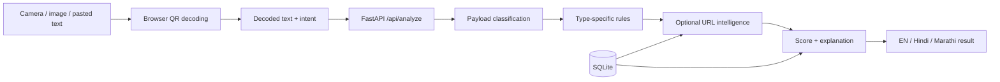

# QR Shield — implementation walkthrough and Codeastra review

> Historical review before the UI and Vercel update. Several scoring gaps listed here have since been fixed. See the current README and [Vercel deployment guide](VERCEL_DEPLOYMENT.md) for the latest behavior and verification results.

Reviewed on 9 October 2026 by reading the source, building the frontend, running the tests, exercising the live API, and checking the browser UI. This document describes the current implementation; proposed changes below have not been applied.

## What the app does

QR Shield helps a person understand a QR code before allowing it to launch a website or another app. Its strongest idea is checking the user's intention against the QR's actual action. A normal shop payment QR looks safe when someone intends to pay, but becomes a danger warning when someone expects to receive money.

The second strong use case is detecting replaced shop payment stickers. The merchant saves a trusted baseline QR; subsequent scans compare its UPI ID against that baseline, even when a replacement copies the shop's displayed name.

This is a React web app packaged as a PWA, with a Python FastAPI backend. Detection uses explicit rules and threat intelligence. There is no trained ML model or blockchain implementation.

## Run and explore

The running app is at http://127.0.0.1:8000/.

| Page | Address | Purpose |
|---|---|---|
| App | http://127.0.0.1:8000/ | Scanner, history and shopkeeper interface |
| Demo sheet | http://127.0.0.1:8000/demo/sheet | Printable sample QR codes |
| API explorer | http://127.0.0.1:8000/docs | FastAPI's generated endpoint documentation |
| Health | http://127.0.0.1:8000/api/health | Current mode, feed counts and optional key availability |

An additional launcher was saved at `.runtime/start-app.ps1`. Run it from PowerShell when the app is stopped. It binds to localhost and writes temporary files, PID and logs under the D: project. Do not start another copy while port 8000 is occupied. Installed Python and Node executables were used; new environments, dependencies, caches, database, screenshots and review files were placed on D:.

For a phone, a remotely hosted HTTPS deployment or a deliberate LAN/HTTPS setup is needed. A phone's localhost refers to the phone, not this laptop. Phone camera permission, physical camera quality and installation on Android/iOS were not verified in this review.

## Screens and user flow

**Scan:** Choose Just checking, Paying a shop, Receiving money or Paying a bill. Start the camera, upload a QR image, or paste decoded QR text. All four intent options exist, but the explicit receive-versus-pay override is the most significant context-sensitive rule; the other choices do not each have a separate comprehensive verification workflow.

**Result:** A green, amber or red card shows the verdict, heuristic score and analysis time. Payment results show the payee, UPI ID, amount, editability and note. URL results can show a redirect destination and domain age. Reasons are displayed in English, Hindi or Marathi. Optional online checks expose statuses such as skipped, demo, cached or timeout.

**Opening:** Analysis does not automatically launch the QR destination on the user's device. The user can choose to open it afterward. A danger result requires an acknowledgement checkbox before continuing. Detected USSD telephone codes have their opening button suppressed. This protects scans performed inside QR Shield; it does not intercept scans from every other camera or payment app on the phone.

**History:** Up to 50 unique payloads are kept in browser localStorage. Repeated scans of the same payload replace its prior entry. History can be cleared or an item analyzed again. Raw payloads remain in local history, so this is not a hash-only storage system across the whole app.

**My Shop:** Register a genuine payment QR and a shop name. The backend assigns a six-character shop code and stores the UPI ID. The browser saves that shop selection. A later scan compares UPI IDs, with an additional name-change warning. Matching proves consistency with the saved baseline; it does not establish ownership of the bank account.

**Report this QR:** Submit an optional reason. SQLite stores the payload hash, reason and timestamp. Future analysis of the identical payload includes its report count. Reports are rate-limited by client IP to ten per minute, but repeated reports from one person are not deduplicated.

## How analysis works

The browser uses native BarcodeDetector where QR detection is supported, with ZXing-C++ WebAssembly as the fallback. The WASM file is hosted by this project. The image itself is decoded on the client; the decoded text is sent to the backend.

`engine.py` classifies the payload, runs its analyzer, checks embedded links or UPI IDs where supported, adds community reports, and sums the weighted signals. Scores are clamped to 0–100. SAFE is 0–24, CAUTION is 25–59, and DANGER is 60–100. Some rules force danger. A strong positive risk signal cannot be reduced all the way to safe by negative trust weights.

The number is a heuristic risk score, not a measured probability of fraud. The language text is authored in translation dictionaries rather than generated by an LLM.

## Implemented analyzers

| Payload | Current behavior |
|---|---|
| UPI payment | Parses payee, name, amount, currency, note, merchant code, signature field and reference URL; checks malformed IDs, duplicates, lookalike handles, impersonation, bait words and unusual payment patterns |
| UPI mandate / AutoPay | Extracts recurrence, expiry, revocability and amount rule; flags recurring debits and additional risks |
| Other UPI actions | Flags anomalous actions such as a collect-style QR |
| Bharat QR / EMV | Parses TLV fields, checks CRC16, extracts a UPI ID where possible, and reuses payment rules |
| Web URLs | Checks lookalike characters, misspellings, impersonation, userinfo tricks, risky hosting/TLDs, shorteners, download paths and other lexical indicators |
| Wi-Fi | Explains network details and flags open, WEP or suspiciously named networks; does not verify the actual access point |
| Phone / SMS | Identifies USSD/call-forwarding patterns and some suspicious numbers/messages; analyzes embedded links in SMS |
| Email / contacts / calendar | Explains the requested action, checks some social engineering patterns and embedded URLs |
| App / intent links | Examines packages and browser fallback URLs, including remote-access app indicators |
| Chat links | Explains the app, destination and some prefilled messages |
| Crypto | Warns about payment behavior; does not validate blockchain activity |
| FIDO / OTP | Identifies login or authenticator-secret behavior; does not verify the requesting service |
| Location / text | Explains basic content and checks supported embedded links/UPI IDs and scam words |
| Dangerous schemes | Forces danger for javascript, data, vbscript and file schemes |

The bundled data currently contains **183 known UPI handles** and **95 official-domain entries**. These are static reference lists, not live account ownership checks. Some older documentation still says 181 handles.

## URL intelligence and backend security

URL rules use an offline Public Suffix List and Unicode confusable data, with RapidFuzz edit-distance comparisons. Optional checks add RDAP domain age, redirect expansion, cached public threat feeds, Google Safe Browsing and the URLhaus API.

The redirect fetcher restricts schemes and ports, resolves and filters IP addresses, pins the connection to a validated public IP, validates redirect hops, retains Host/TLS SNI, avoids JavaScript execution and limits fallback GET bodies to 64 KB. The SSRF tests cover internal-address redirects and public-IP pinning. This is meaningful backend protection, but the suite is not a comprehensive penetration test.

SQLite stores threat entries, feed refresh metadata, RDAP cache, reports and registered shops. Database access is guarded by a process-local lock. The app has no merchant login, distributed rate limiter, multi-instance deployment design or established production monitoring.

Feeds are loaded at startup if enabled and stale. Although the function has a six-hour freshness threshold, there is no scheduled refresh loop while the server stays up. RDAP cached values also have no expiry check.

## What was actually verified

| Check | Observed result |
|---|---|
| Production frontend build | Passed: TypeScript + Vite + generated PWA service worker |
| Existing pytest suite | 142 passed in 3.01 seconds; one Starlette/httpx deprecation warning |
| Live demo verifier | All 15 scan samples and both shop sticker checks passed |
| Browser payment flow | Green result showed the correct payee and UPI ID |
| Browser intent mismatch | Same QR turned red for Receiving money |
| Browser languages | Hindi and Marathi result explanations displayed correctly |
| Browser history | A scanned payload appeared in local history |
| Browser shop flow | Registration and replacement warning worked with the same displayed shop name |
| Browser image upload | A generated QR PNG from D: decoded and returned the expected payment result |
| Live OpenPhish feed | 300 entries downloaded |
| Live PhishTank feed | 69,031 entries downloaded |
| Live URLhaus bulk feed | 28,104 entries downloaded |
| Optional keyed APIs | Google Safe Browsing and URLhaus API keys absent; keyed lookups not verified |
| Camera / real phone | Implementation inspected; physical capture and phone deployment not tested |

The first build and test attempts encountered Windows sandbox restrictions. The permitted retries passed. Those restrictions were environmental failures, not app failures.

## Honest boundaries for the pitch

1. **Offline:** The PWA shell and QR decoding are cached. Server heuristics can run without external internet if the client can still reach the server. Full phone-only offline analysis is not implemented.
2. **Demo:** The running app defaults to DEMO_MODE=1. Reserved sample domains use fixture redirects/domain ages, two payloads have seeded reports, and a feed example is synthetic. Real public feeds also loaded successfully. Label these sources separately.
3. **Verification:** The app does not cryptographically verify NPCI signatures, resolve bank-registered account-holder names or prove merchant ownership.
4. **Accuracy:** Passing 142 tests proves the tested behavior. There is no held-out detection benchmark, measured false-positive rate or validated probability calibration yet.
5. **Privacy:** Reports store hashes, but analysis receives decoded payloads; history stores raw payloads; shop registration stores a UPI ID; online checks may share URLs with intelligence providers. OTP secrets and Wi-Fi credentials deserve stricter handling.

## Reproduced gaps to fix first

These were checked in isolated in-memory storage by `.runtime/review-probes.py`, without poisoning the live demo data.

| Priority | Evidence | Recommended change |
|---|---|---|
| P0 | `https://` produced SAFE, score 0, no checks | Validate URLs before scoring; reject malformed input or return an inconclusive result |
| P0 | An unresolved bit.ly URL with online checks disabled produced SAFE, score 10 | Show that the destination is unknown; prevent a reassuring green verdict when essential checks did not complete |
| P0 | A normal monthly, revocable mandate produced DANGER, score 60 | Explain recurring debit with caution; escalate for deceptive context, receive intent or other concrete risks |
| P0 | Any syntactically valid base64 signature earns -5 without verification | Give signature presence zero trust weight until cryptographically verified |
| P0 | Four repeated reports changed a clean QR from SAFE to DANGER | Count independent reports, add deduplication/moderation, and distinguish allegation from verified intelligence |
| P1 | Official domains skip redirect expansion in `analyze_url` | Inspect redirects even for trusted starting hosts; score the actual destination |
| P1 | Shortener explanation says “We followed it” even when redirects are skipped | Make explanations reflect the actual completed checks |
| P1 | Merchant registration accepts a baseline without ownership authentication | Add merchant access control, stricter QR validation and a clearly stated baseline trust model |
| P1 | Phone-only offline analysis is absent | Port the core UPI/intent rules to the client and test with the backend unavailable |
| P1 | No evaluation corpus or latency benchmark | Measure results on separate benign/malicious examples and a phone QR-decoding set |
| P2 | OTP/Wi-Fi payloads reach the server and local history | Analyze sensitive types locally; redact or avoid persistent sensitive history |

## Changes most likely to improve the Codeastra entry

**Focus the product story:** “Before a QR can move your money, QR Shield explains what it will do and checks whether that matches your intent.” Demonstrate receive-versus-pay first and merchant sticker replacement second. Keep broad QR compatibility as supporting functionality.

**Fix uncertainty and false positives before adding breadth:** Separate “no suspicious signals” from “destination checked” and “could not verify.” A security jury can challenge a green result after an error. Also separate a legitimate subscription from a deceptive mandate.

**Make the strongest feature work without the backend:** A small client-side UPI parser and intention rule would turn the offline promise into a demonstrable feature. Retain server intelligence as an enhancement.

**Make shop protection trustworthy:** Require a deliberate trusted enrollment, protect merchant management, and preserve/export the baseline. A customer-facing signed merchant identity is a possible next differentiator, provided it solves an actual ownership problem and its trust chain is explained.

**Bring evidence:** Build a labeled corpus with ordinary merchant payments, legitimate subscriptions, unfamiliar but valid handles, phishing URLs and malformed payloads. Hold some examples out of tuning. Report precision, recall, false positives, sample sizes and p50/p95 latency. Add image tests for blur, rotation and low light. Do not advertise an accuracy percentage before measuring it.

**Polish practical use:** Deploy over HTTPS, make the default language choice clear, keep warnings readable, improve keyboard/accessibility support, and replace native prompt-based reporting with an inline form and visible success/error states. Provide screenshots, architecture, source attribution, environment examples and reproducible setup.

**Prepare a real integration:** The existing `/api/analyze` contract can serve a partner team's dashboard or workflow. Add a stable response contract and request limits; demonstrate the partner using the returned risk signals to change behavior.

**Test adaptability:** Prepare to explain how stricter authentication, an API timeout, a network outage or traffic increase would affect the current modules. Add only the adaptation required by the actual challenge.

## Codeastra alignment and rules

The [official event page](https://www.rgitabit.in/codeastra) lists QR Code Safety Scanner under Cybersecurity & Blockchain and says final problem statements arrive at launch. QR Shield matches the listed starting problem.

The [downloadable rulebook](https://www.rgitabit.in/pdfs/MAIN%20CODEASTRA%202.0%20RULEBOOK_compressed.pdf) gives functionality 25 marks, alignment/technical implementation/innovation 15 each, and UX/impact/presentation 10 each. It specifies a five-minute pitch, three-to-five-minute live demo and two-minute Q&A. Its rubric differs from the website summary; confirm the operative rubric with organizers.

The rulebook prohibits prebuilt submissions and requires disclosure of major pre-existing components. Treat this existing project as preparation or selection-stage material; follow organizer instructions about code allowed in the final build. AI tools are permitted, but the team must understand and explain the code and acknowledge AI assistance.

## Suggested four-minute demonstration

| Time | Show | Point to explain |
|---|---|---|
| 0:00–0:40 | Ordinary shop QR | The app explains who receives payment |
| 0:40–1:20 | Same QR with Receiving money | Intent mismatch creates the stop warning |
| 1:20–1:50 | Switch Hindi/Marathi | Reasons are understandable to the intended users |
| 1:50–2:35 | Register a genuine QR, scan a replacement | Name stays the same; payment destination changes |
| 2:35–3:15 | Lookalike or redirected sample URL | Explain lexical checks and explicitly label fixture evidence |
| 3:15–4:00 | Health/check status and measured results | Show live feed availability, tested boundaries and evaluation evidence |

Use real QR image/camera input during the final demo, with text paste as a backup. Keep the current offline and verification limits visible until their implementations change.

## Source map

| Path | Responsibility |
|---|---|
| `frontend/src/App.tsx` | Main screens, state, result actions, history and shop flows |
| `frontend/src/scanner.ts` | Camera and image decoding |
| `frontend/src/api.ts` | Typed API calls and client timeout |
| `frontend/src/i18n.ts`, `styles.css` | UI translations and appearance |
| `frontend/vite.config.ts` | Build, manifest, caching and dev proxy |
| `backend/app/main.py` | API endpoints, startup and static frontend hosting |
| `backend/app/engine.py` | Classification, orchestration and final scoring |
| `backend/app/analyzers/` | UPI, EMV, URLs and other payload-specific rules |
| `backend/app/ssrf.py` | Restricted redirect fetching |
| `backend/app/intel.py`, `rdap.py` | Threat intelligence and registration-date checks |
| `backend/app/domainutil.py`, `homoglyph.py`, `data/` | Domain parsing and reference datasets |
| `backend/app/db.py` | SQLite schema and persistence |
| `backend/app/models.py`, `config.py`, `i18n.py` | Input schemas, configuration and explanations |
| `backend/tests/` | Existing automated tests |
| `demo/` | Sample QR definitions, sheet and live verifier |
| `docs/` | Research, design, differentiation, demo script and pitch deck |

The copied project folder has no `.git` repository. Initialize version control and prepare the required source repository as part of submission work.
